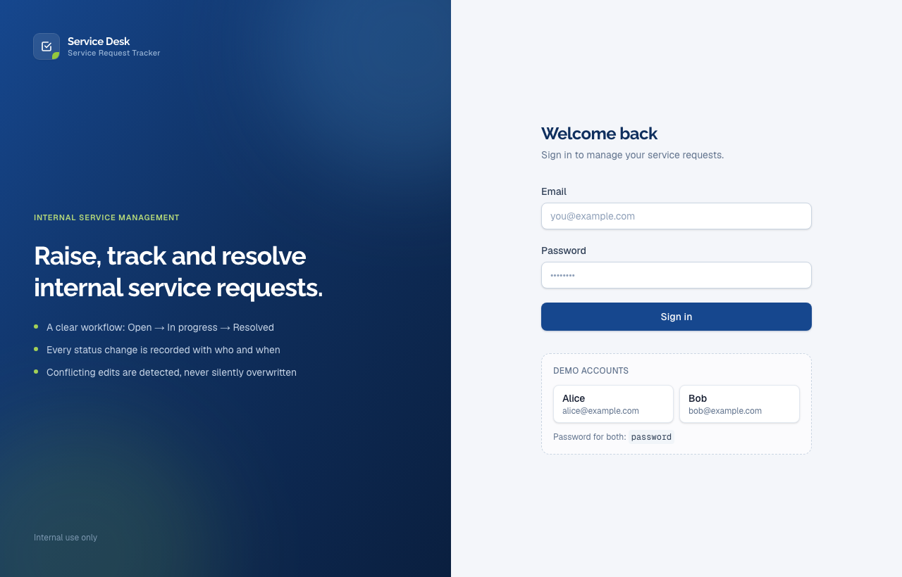
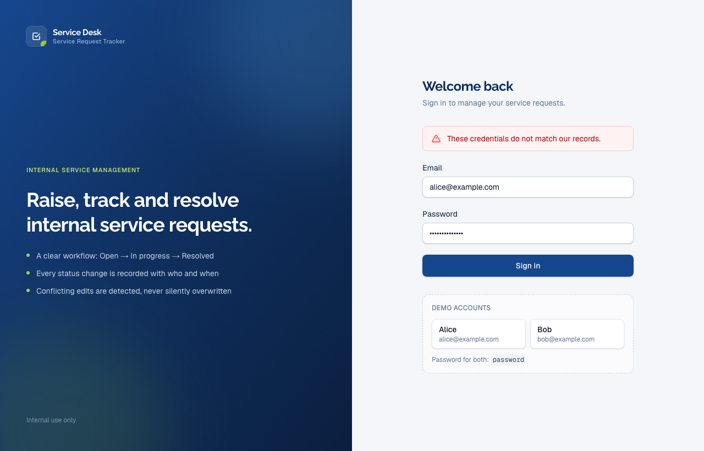
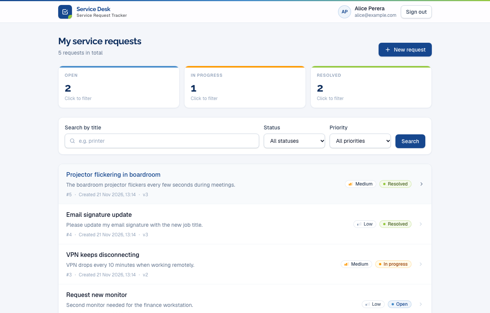
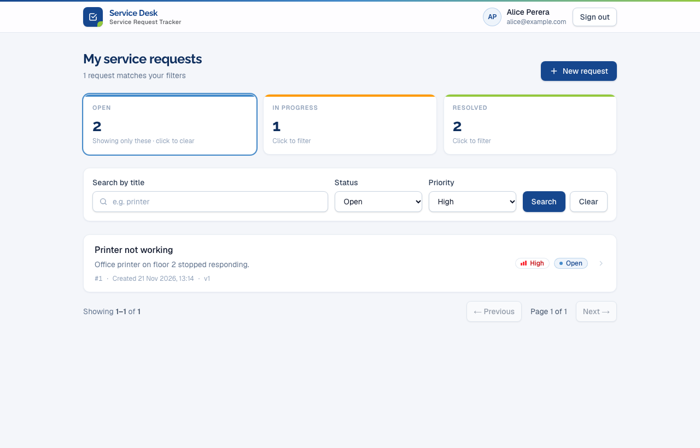
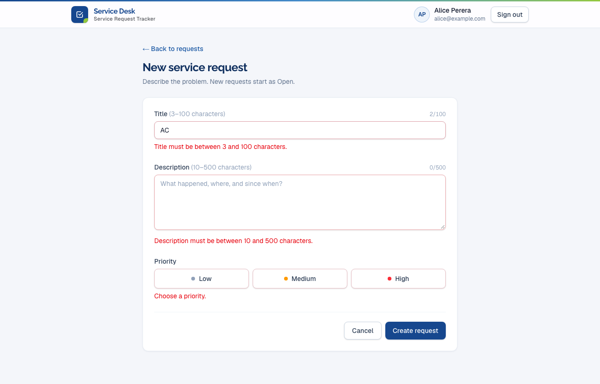
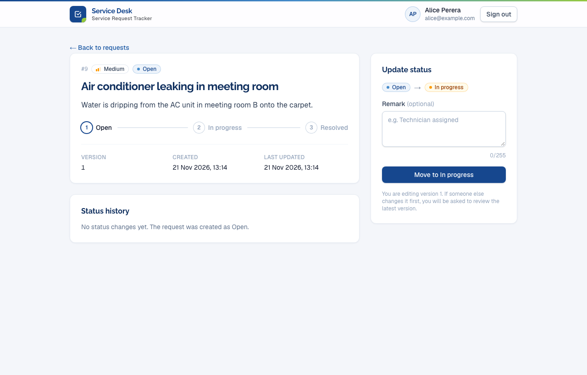
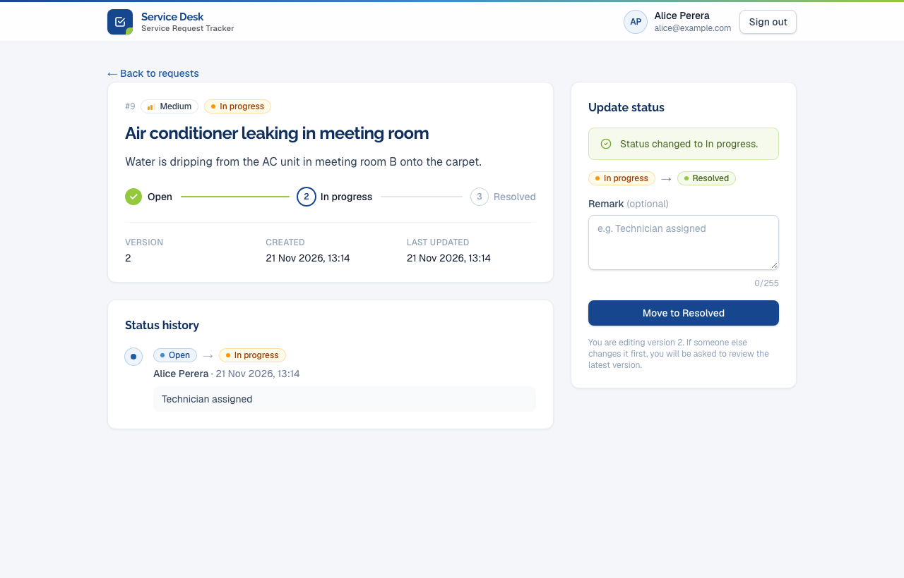
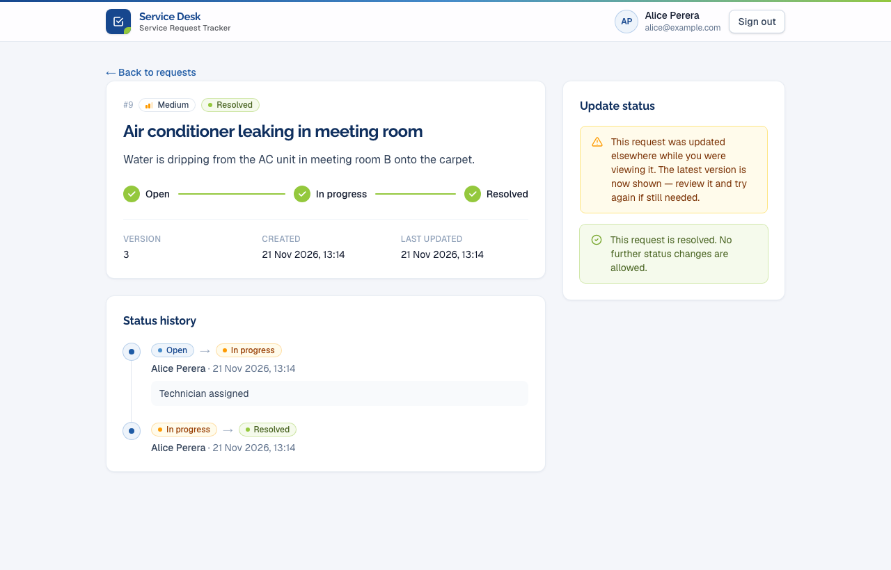
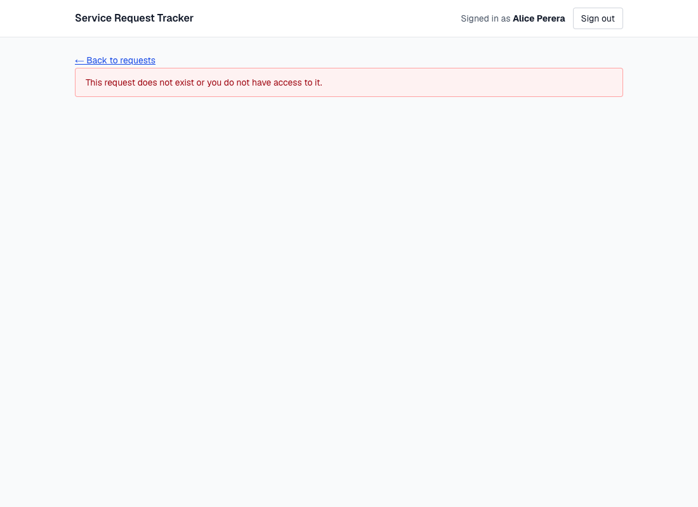
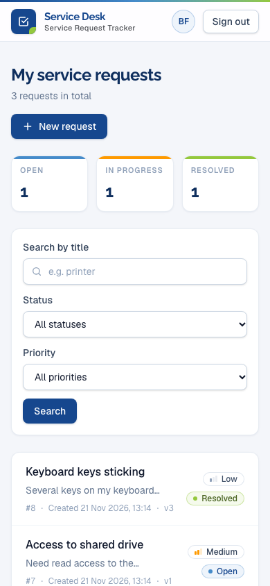

# Service Request Tracker

A small, secure service request tracker. Employees sign in, raise their own service requests, and move them through a fixed workflow (`OPEN → IN_PROGRESS → RESOLVED`). Every status change is recorded, and a change based on an out-of-date version is rejected instead of overwriting newer data.

| Part | Stack | Folder |
|---|---|---|
| API | Laravel 13, Sanctum 4 (SPA cookie auth), PHP 8.3+ | [`backend/`](backend) |
| UI | Next.js 16 (App Router), React 19, TypeScript, Tailwind CSS | [`frontend/`](frontend) |
| Database | SQLite (no setup needed); MySQL/PostgreSQL work via `.env` | `backend/database/` |

---

## 1. Quick start

**Requirements:** PHP ≥ 8.3 with `pdo_sqlite`, Composer 2, Node.js ≥ 20, npm.

### Backend (http://localhost:8000)

```bash
cd backend
composer install
cp .env.example .env
php artisan key:generate
touch database/database.sqlite
php artisan migrate --seed
php artisan serve            # http://localhost:8000
```

### Frontend (http://localhost:3000)

```bash
cd frontend
npm install
cp .env.example .env.local   # NEXT_PUBLIC_API_URL=http://localhost:8000
npm run dev                  # http://localhost:3000
```

> Open the app at **http://localhost:3000**, not `127.0.0.1:3000`. The session and CSRF cookies are set for `localhost`. If the two hosts don't match, the browser won't send the cookies.

### Demo users (seeded)

| Email | Password |
|---|---|
| `alice@example.com` | `password` |
| `bob@example.com` | `password` |

Alice gets 5 sample requests and Bob gets 3, covering every status (Open, In progress, Resolved), so you can check that one user can't see the other's data. The seeder moves requests through the workflow with the same `StatusTransitionService` the API uses, so their versions and status history are real.

### Tests

```bash
cd backend
php artisan test
```

The tests use an in-memory SQLite database (see `phpunit.xml`), so they never touch your local data. Current result: **22 tests, 164 assertions, all passing.**

Frontend checks: `cd frontend && npm run lint && npm run build`.

---

## 2. Authentication: why Sanctum SPA cookies

The frontend and the API are both first-party and run on the same site (`localhost`). I chose **Sanctum's cookie-based SPA authentication** over API tokens or JWT for these reasons:

- **No token in JavaScript.** The session lives in an `HttpOnly` cookie, so a cross-site scripting (XSS) bug can't read and steal it. That is not true of a JWT kept in `localStorage`.
- **Real logout.** `POST /api/auth/logout` invalidates the session on the server. A stateless JWT stays valid until it expires unless you add a denylist.
- **CSRF protection is built in.** The SPA calls `GET /sanctum/csrf-cookie`, and Laravel sets an `XSRF-TOKEN` cookie. The frontend sends it back in the `X-XSRF-TOKEN` header on every POST or PATCH. A request without a valid token gets `419`. The client fetches a fresh token and retries once.

How it is configured:

| Setting | Value | Where |
|---|---|---|
| Stateful SPA origins | `SANCTUM_STATEFUL_DOMAINS=localhost:3000,127.0.0.1:3000` | `backend/.env` |
| CORS | only `FRONTEND_URL` is allowed, `supports_credentials=true`, paths `api/*` and `sanctum/csrf-cookie` | `backend/config/cors.php` |
| Session cookie | `HttpOnly`, `SameSite=Lax`, `SESSION_DOMAIN=localhost`, lifetime 120 min (`SESSION_LIFETIME`) | `backend/.env`, `config/session.php` |
| Passwords | bcrypt via the `hashed` cast | `app/Models/User.php` |
| Brute-force protection | 5 login attempts per minute per email + IP (`429`) | `AppServiceProvider` |
| Session fixation | session ID regenerated on login; session invalidated and CSRF token rotated on logout | `AuthController` |

In production, set `SESSION_SECURE_COOKIE=true` and serve the site over HTTPS. `.env.example` contains no secrets. Each developer generates their own `APP_KEY`.

---

## 3. Data model

```
users 1───* service_requests 1───* request_status_histories *───1 users (actor)
```

**`service_requests`**: `id`, `created_by` (FK → users, cascade), `title` (varchar 100), `description` (varchar 500), `priority` (`LOW|MEDIUM|HIGH`), `status` (`OPEN|IN_PROGRESS|RESOLVED`, default `OPEN`), `version` (unsigned int, default 1), timestamps.

- Index `(created_by, created_at)`: the list query, which shows the owner's requests newest first.
- Index `(created_by, status, priority)`: the list query with the combined status and priority filter.

**`request_status_histories`**: `id`, `service_request_id` (FK, cascade), `actor_user_id` (FK → users, restrict), `from_status`, `to_status`, `remark` (nullable, ≤255), `created_at`.

- Rows are only ever added, never edited, so the table has no `updated_at`.
- Index `(service_request_id, id)`: reads one request's history in order.
- One row is written per successful transition. Creating a request does not write a history row; the creation time is on the request itself.

Status and priority are stored as strings and mapped to PHP enums (`app/Enums`). The allowed transitions are defined in one place: `RequestStatus::next()`.

---

## 4. API

Base URL: `http://localhost:8000/api`. All endpoints except `login` require an authenticated session.

| Method | Endpoint | Success | Notes |
|---|---|---|---|
| POST | `/auth/login` | `200 {data: user}` | `{email, password}`. Wrong credentials return `422`; too many attempts return `429`. |
| GET | `/auth/me` | `200 {data: user}` | `401` if not signed in |
| POST | `/auth/logout` | `200 {message}` | Invalidates the server session |
| GET | `/requests` | `200` paginated | `search`, `status`, `priority`, `page`, `per_page` (default 10, max 25). Only the signed-in user's requests, newest first. |
| POST | `/requests` | `201 {data}` | `{title, description, priority}`. Any `created_by`, `status` or `version` in the body is ignored. |
| GET | `/requests/{id}` | `200 {data}` | Includes `version` and `allowed_next_status` |
| PATCH | `/requests/{id}/status` | `200 {data}` | `{status, expected_version, remark?}` |
| GET | `/requests/{id}/history` | `200 {data: [...]}` | Oldest first |

### Response shapes

```jsonc
// Service request
{ "data": { "id": 6, "title": "Printer jam", "description": "...", "priority": "HIGH",
            "status": "IN_PROGRESS", "version": 2, "allowed_next_status": "RESOLVED",
            "created_by": 1, "created_at": "2026-11-21T06:11:41+00:00", "updated_at": "..." } }

// List: standard Laravel resource pagination
{ "data": [ ... ], "links": { ... }, "meta": { "current_page": 1, "last_page": 3, "per_page": 10, "total": 23, ... } }

// History entry
{ "id": 1, "service_request_id": 6, "from_status": "OPEN", "to_status": "IN_PROGRESS",
  "remark": "Technician assigned", "actor": { "id": 1, "name": "Alice Perera" }, "created_at": "..." }
```

### Errors

Every error uses the same envelope: `{ "message": string, "code": string, ...extra }`.

| HTTP | `code` | When |
|---|---|---|
| 401 | `UNAUTHENTICATED` | No valid session |
| 404 | `NOT_FOUND` | Unknown ID **or a request owned by someone else** |
| 409 | `STALE_VERSION` | `expected_version` ≠ current version. Extra fields: `current_version`, `current` (the latest request) |
| 409 | `INVALID_TRANSITION` | Skipping a step, going backwards, a no-op, or any change after `RESOLVED`. Extra fields: `current_status`, `allowed_next_status` |
| 419 | `CSRF_TOKEN_MISMATCH` | Missing or expired CSRF token |
| 422 | `VALIDATION_FAILED` | Invalid fields. Extra field: `errors: {field: [messages]}` |
| 429 | `TOO_MANY_REQUESTS` | Login rate limit hit |

**Records owned by someone else return 404.** Every query starts from `$request->user()->serviceRequests()`, so another user's record is never loaded. This also means the API doesn't reveal whether a given ID exists. The rule applies the same way to detail, history and status updates.

**Order of checks for `PATCH /status`:** `401` (auth) → `422` (body validation) → `404` (ownership/existence) → `409 STALE_VERSION` → `409 INVALID_TRANSITION`. The version is checked first: if the client's copy is out of date, any decision it made about the transition is unreliable anyway.

---

## 5. Concurrency and integrity

`App\Services\StatusTransitionService` runs everything in one database transaction:

1. Re-read the row with `lockForUpdate()`. In MySQL and PostgreSQL this is `SELECT … FOR UPDATE`. SQLite serialises writers, so it gets the same effect.
2. If `version ≠ expected_version`, return `409 STALE_VERSION` with the latest state.
3. If the transition isn't allowed by `RequestStatus::canTransitionTo()`, return `409 INVALID_TRANSITION`.
4. Run a **conditional** update:
   `UPDATE service_requests SET status=?, version=version+1 WHERE id=? AND version=? AND status=?`.
   If zero rows change, another write landed first, so return `409 STALE_VERSION`. This guard holds even if the database ignores row locks.
5. Insert exactly one `request_status_histories` row.

Any exception rolls back the whole transaction, so a failed update never leaves an audit row behind, and a status change is never committed without its audit row.

---

## 6. Frontend

- **Session-aware.** `AuthProvider` calls `/api/auth/me` on load. Pages under `/requests/*` sit behind `RequireAuth`, which redirects to `/login`. Any `401` from the API fires an event that signs the user out locally. If that happens mid-use (the session expired or was cleared), the user goes to `/login?expired=1&next=…`, sees "Your session has expired", and after signing in returns to the same page, search and filters included. `next` is only accepted if it starts with `/requests`, so it can't be used as an open redirect.
- **List** (`/requests`). Search, status and priority filters plus pagination are stored in the URL query string, so they survive a refresh or the back button. All filtering and paging happens on the server. The page has loading, empty, "no matches" and error-with-retry states.
- **Summary tiles.** Above the list, three tiles show how many requests are Open, In progress and Resolved; clicking one applies that status filter. The counts come from the existing list endpoint (`?status=X&per_page=1`, reading `meta.total`), so no extra API was added. With more statuses or heavy traffic I would replace this with one `GET /api/requests/summary` that returns grouped counts.
- **Create** (`/requests/new`). The form checks inputs in the browser first, mirroring the server rules. Field errors from a `422` are shown next to each field, linked with `aria-describedby`.
- **Detail** (`/requests/[id]`). Shows the current version and status, and a single action button for the next allowed status (taken from the server's `allowed_next_status`) with an optional remark. History is listed oldest first.
- **Stale update (409).** The screen replaces its data with the latest request from the response, reloads the history, and explains that the request changed elsewhere. The user can then decide again using the fresh version.
- **Detail** also shows a progress stepper (Open → In progress → Resolved) and the history as a timeline.
- **Styling.** Plain Tailwind CSS, no component library. The colour palette comes from the Lalan Rubbers logo (navy `#16478E`, blue `#458BCA`, leaf green `#94C83D`) and is defined once as theme tokens in `src/app/globals.css`. Headings use Raleway.
- Accessibility: every input has a `<label>` (the priority picker is a `<fieldset>` of radio buttons), alerts use `role="alert"`, there are live regions for status messages, and the layout is responsive (see the mobile screenshot).

---

## 7. Screenshots

| | |
|---|---|
| Login |  |
| Wrong credentials |  |
| Request list |  |
| Search + combined filters |  |
| Create: validation |  |
| Detail (OPEN, v1) |  |
| After transition (IN_PROGRESS, v2) |  |
| Stale update (409) handled |  |
| Another user's request |  |
| Mobile, signed in as Bob |  |

---

## 8. Tests (`backend/tests`)

| File | What it covers |
|---|---|
| `Feature/AuthTest` | Successful sign-in and `/me`; wrong password returns `422`; **every protected route returns `401`** when signed out; logout ends the session |
| `Feature/ServiceRequestAccessTest` | **Another user's detail, history and status update all return `404`, and nothing changes**; unknown ID returns `404`; the list shows only the user's own requests, newest first; search plus combined filters, `%` treated literally, pagination defaults and limits, `422` on invalid filters |
| `Feature/CreateServiceRequestTest` | **Creation succeeds**, and spoofed `created_by`, `status` and `version` are ignored; **invalid input returns `422`** (lengths, priority, missing fields) |
| `Feature/StatusTransitionTest` | **A valid transition is saved, the version goes up by 1, and exactly 1 history row is written**; the full workflow plus history order; **7 invalid or no-op transitions return `409` with no changes**; **a stale `expected_version` returns `409` and the newer state is kept**; a future version is rejected; a malformed body returns `422` |
| `Unit/RequestStatusTest` | The transition table allows exactly `OPEN→IN_PROGRESS` and `IN_PROGRESS→RESOLVED` |

---

## 9. Out of scope / possible next steps

- Registration, password reset and email verification are out of scope, as the brief says.
- There is no role for support staff or admins: owners move their own requests through the workflow.
- Next steps I would take: an end-to-end Playwright suite in CI, a `Policy` class if roles are added, and soft deletes if requests ever become deletable.

---

## 10. AI Use & Verification

<!-- TODO (Sanjana): review this section and make sure every statement is accurate before submitting. -->

- **Tools used:** Claude Code (AI coding assistant).
- **Work assisted:** setting up the Laravel and Next.js projects, writing the backend (migrations, enums, controllers, `StatusTransitionService`, error handling), the feature tests, the Next.js pages, the visual redesign of the UI using the Lalan Rubbers brand colours, and drafting this README.
- **Representative prompt:** *"Build this Service Request Tracker assignment (Laravel API + Next.js UI) exactly as the brief specifies, with Sanctum auth, optimistic locking for status changes and at least six tests."*
- **How the output was verified and corrected:**
  - Ran `php artisan test` (22 tests passing) and read each test against the brief's acceptance criteria.
  - Called every endpoint by hand with `curl`: CSRF cookie → login → `/me` → create → valid, stale and invalid transitions → history → logout. This confirmed the status codes and the JSON shape, including `419` when the CSRF header is missing.
  - Drove the UI in a headless browser through the full flow: redirect when signed out, wrong password, filters, create with validation errors, transition, a stale update from a second tab, opening another user's request, logout, and the mobile layout. The screenshots above come from that run.
  - Corrections made along the way: switched to PHPUnit 12's `#[DataProvider]` attribute after the docblock form failed; rewrote two React effects flagged by the `react-hooks/set-state-in-effect` lint rule; turned off Next.js's experimental `cacheComponents` flag, which the template enables by default and this client-rendered UI doesn't need; during the redesign, found (from the screenshots) that the shared `.input`/`.btn-*` classes were overriding Tailwind utilities such as `pl-9`, checked the compiled CSS to confirm it, and switched those few overrides to Tailwind's `!` modifier.
- **Independent technical decision:** <!-- TODO (Sanjana): describe one decision you made yourself and why. -->
